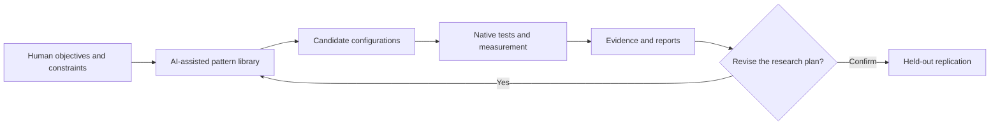

# AI-Orchestrated Experimental Development

**Beyond writing code: automation, higher-level abstraction, and experimentally grounded software development.**

**A research manuscript and open documentation project by Gustave · Abstract Mechanisms.**  
**Status:** **preprint published on Zenodo on 20 October 2026**; living repository manuscript and public research notes remain under revision · **not peer reviewed**.

**Published scientific preprint:** **Gustave Leblanc** (2026), *Beyond Writing Code: Automation-Driven Abstraction Shifts in AI-Orchestrated Experimental Software Development*, **Zenodo v1**. **DOI: [10.5281/zenodo.23503438](https://doi.org/10.5281/zenodo.23503438)** · [Publication record and PDF](https://zenodo.org/records/23503438). This is a public, citable **preprint, not a peer-reviewed journal article**. The Zenodo record is version `v1`; the deposited PDF filename contains `v1.3` (editorial manuscript version).

> **Central proposition.** When technical operations become sufficiently reliable and automated, human work can shift toward the design, coordination and assessment of higher-level systems. Generative AI may extend this shift from compilation and model transformation to implementation, experiment construction and evidence analysis. This does *not* mean that code, programmers, or low-level expertise have become unnecessary.

The central contribution is **not a record JSON parsing speedup**. This repository examines a method for directing low-level technical research through AI-assisted implementation, an extensible library of optimization patterns, experimental campaigns, retained negative results, and iterative reports. [VLA-MethodLab](https://github.com/MA-Gustave/VLA-MethodLab) provides the experimental case study, while [VectorPath-RVV](https://github.com/MA-Gustave/VectorPath-RVV) contains the resulting implementation; neither is the identity of this manuscript repository.

## Start reading

| Resource | What it covers |
| --- | --- |
| **[Published preprint — Zenodo DOI](https://doi.org/10.5281/zenodo.23503438)** | **Canonical citable deposit** (Gustave Leblanc, 20 October 2026; not peer reviewed) |
| [Full research manuscript](manuscript/ARTICLE_EN.md) | Living repository manuscript, **not byte-identical** to deposited PDF |
| [Abstract](manuscript/ABSTRACT_EN.md) | Concise overview for readers and prospective reviewers |
| [Research governance and rights](docs/INDEPENDENT_GOVERNANCE_AND_ROADMAP.md) | AI contribution rules, independent licensing boundary and confidential future direction |
| [Research thesis and scope](docs/THESIS_AND_SCOPE.md) | What is proposed, observed, and not demonstrated |
| [Conceptual framework](docs/CONCEPTUAL_FRAMEWORK.md) | Aristotle, Simon, Licklider, Engelbart, automation |
| [Public research method](docs/PUBLIC_METHOD.md) | Patterns → candidate plans → experiments → reports → revision |
| **[Final native evidence — Test 106/107](docs/FINAL_NATIVE_RESULTS_2026-10-18.md)** | Frozen A2 stable, two native hosts, 18-file dataset, negative findings and historical release hold |
| [RVV-VLA case study](docs/RVV_VLA_CASE_STUDY.md) | Historical E14 vs final A2: different baselines, methods and claim boundaries |
| [Evidence ledger](docs/EVIDENCE_LEDGER.md) | Claims, source links, evidence category and caveats |
| [18-document CSV](evidence/TEST106_Public_18JSON_PerDocument_Results_EN.csv) / [verification script](scripts/verify-test106-summary.py) | Derivative public-file table and recalculation, not native raw archives |
| [JSON workload metadata hypothesis](docs/JSON_METADATA_HYPOTHESIS.md) | Optional hints for workload-aware engine choice |
| [Research questions](docs/RESEARCH_QUESTIONS.md) | Falsifiable hypotheses and evaluation plans |
| [Annotated references](references/REFERENCES.md) / [BibTeX](references/references.bib) | Academic foundations and related work |
| [Wiki source](wiki/Home.md) / [Wiki publishing instructions](docs/WIKI_PUBLISHING.md) | Navigable wiki, stored here as the reviewable source of truth |
| **[Publication record and citation](docs/PUBLISHED_PREPRINT_2026-10-20.md)** | Verified Zenodo metadata, APA/BibTeX, DOI, evidence scope |
| [Publication checklist](docs/PRE_PUBLICATION_CHECKLIST.md) | Remaining future-release and potential journal submission checks |
| **[Publish at MA-Gustave on GitHub](docs/PUBLISH_TO_GITHUB.md)** | GitHub CLI / Git instructions, separate Wiki deployment |

## Working model

The current RVV-VLA E00–E14 set consists of **15 fixed experimental configurations**. It is *not* an autonomous, continuously self-tuning search system. Hypothesis generation and reporting can involve AI; benchmark validity remains a matter of tests, source provenance and human accountability.

## Primary repositories and dataset provenance

- [MA-Gustave/VLA-MethodLab](https://github.com/MA-Gustave/VLA-MethodLab) — research method, experiment orchestration, candidate patterns, measurement records and validation workflows.
- [MA-Gustave/VectorPath-RVV](https://github.com/MA-Gustave/VectorPath-RVV) — independently governed RVV-VLA JSON engine and implementation.
- [15 E00–E14 candidate plans](https://github.com/MA-Gustave/VLA-MethodLab/blob/main/experiments/PATTERN_LIBRARY.md).
- [Stage 1 / Stage 2 / DOM study](https://github.com/MA-Gustave/VLA-MethodLab/blob/main/docs/results/2026-10-11-stage-profile-8h.md).
- [Measurement methodology](https://github.com/MA-Gustave/VLA-MethodLab/blob/main/docs/METHODOLOGY.md).

### Final frozen native release evidence — 18 October 2026

**Test 106, completed on two native RISC-V targets:** the frozen **VectorPath-RVV A2 stable** release candidate delivered paired, equal-document geometric-mean **DOM throughput ratios** against the **official simdjson 5.0.4 *fallback*** of **1.6007× (+60.07%) on Cloud-V** and **1.8946× (+89.46%) on EPCC** on **18 public JSON files**. These measurements belong to **167,835 recorded rows** in all Test 106 strata (92,435 + 75,400), **not** 167,835 independent documents. The stable engine matches the previous A2 reference within measurement variation (**1.00001×** and **0.99959×**), and its ELFs are SHA-256-identical to old A2 **within each host**. Both engines pass the specified release-candidate performance threshold and report **340/340 JSONTestSuite cases per host without observed disagreement**.

**Crucial negatives:** on **95 valid tiny JSON files** (2–110 bytes), stable is **0.6665×** of fallback on Cloud-V and **0.8497×** on EPCC. The optional `NL4` decoder failed the Cloud-V public non-regression gate and is not shipped by default. Test 107 reported **`ENGINE PASS` but `HOLD_CI_AND_RELEASE_SIGNOFF`** at the time of its read-only audit. A subsequent related-repository CI #78 success is **x86/default-implementation supporting evidence**, not native RVV Valgrind certification, exact frozen-source identity or retroactive release approval. The supplied archives do not establish a public immutable release tag or signed maintainer approval.

**What we verified in this update:** the 18-row derivative CSV reproduces the 1.6007× / 1.8946× geometric means, and the five C++ files listed in the frozen manifest match the supplied VectorPath source. We did **not** receive the two original Test 106 raw native ZIPs, and did not repeat the benchmarks. See the [full bilingual evidence summary](docs/FINAL_NATIVE_RESULTS_2026-10-18.md) / [résultats en français](docs/RESULTATS_NATIFS_FINAUX_2026-10-18.md), [18-document data](evidence/README.md), and [evidence ledger](docs/EVIDENCE_LEDGER.md).

### Earlier exploratory evidence — distinct comparison

The **11 October 2026** native E14 stage-profile campaign reported **6,887 observations** and geometric-mean ratios **1.502× DOM, 1.601× Stage 1, 1.298× Stage 2**, all against **official simdjson 5.0.3 VLS256** on a BPI-F3. Escape-heavy Stage 1 regressions occurred. This historical campaign remains evidence for the experimental process; it is **not** the final A2 release benchmark, and its baseline/corpus/machine/protocol differ from Test 106. The historical source was a modified working tree and its upstream SHA cannot reconstruct all measured bytes.

## Independent research governance and software rights

The upstream [simdjson AI Usage Policy](https://github.com/simdjson/simdjson/blob/master/AI_USAGE_POLICY.md) **permits AI-assisted work subject to meaningful human review and accountability**; it does not ban all AI-generated code. The laboratory's more extensively AI-orchestrated experimental process is developed under **independent governance**, with human responsibility for results and source provenance. No approval or endorsement from the upstream project is implied.

**Rights boundary:** this manuscript gives no new authorization to integrate qualifying, individually identified, independently owned rights-reserved additions from VLA-MethodLab or VectorPath-RVV into the original simdjson codebase. Where valid pre-existing MIT/Apache licences or other legal rights already authorize reuse, they continue to govern. The two projects' provenance registers do **not yet certify** particular additions as restricted. See [Research governance and rights](RESEARCH-GOVERNANCE.md) and the projects' own licence documents.

**Longer-term direction:** a possible integration of this work into a **broader semantic software ecosystem** is contemplated. The technical roadmap is **not public**, and any disclosure is intended to be limited to directly involved core research collaborators. No undisclosed development is offered as evidence for claims in this manuscript.

## Four different claim types

- **Documented observation:** a claim traceable to project data, version identifiers or primary sources; not necessarily independently replicated.
- **Conceptual interpretation:** a philosophical comparison, not empirical proof.
- **Publicly described method:** the parts of the workflow disclosed in sufficient detail to interpret the case study.
- **Research hypothesis:** a proposed mechanism requiring a prospective test, such as out-of-band workload metadata for JSON parsing.

This repository does not claim priority for algorithm selection, program synthesis, autotuning, or hierarchical theories of complexity. Relevant prior work is cited explicitly.

## Why a separate repository?

A scientific argument requires a stable place for its text, references, corrections and review history. The engine and laboratory repositories are primary technical evidence. This repository is the *interpretation and publication layer*: a research article, its methods, and its bibliographic trail.

## Author identity, confidentiality and citation

**Published preprint author:** **Gustave Leblanc** (listed on Zenodo as Leblanc, Gustave), dated **20 October 2026**. The project also uses the *Gustave / Abstract Mechanisms* public identity. The preprint has a verifiable DOI: **[10.5281/zenodo.23503438](https://doi.org/10.5281/zenodo.23503438)**. The repository includes a [machine-readable `CITATION.cff`](CITATION.cff) with this preprint as its preferred citation. No ORCID, additional coauthor, journal acceptance or peer-review status is inferred from the Zenodo record. Software and original-source rights remain governed by their respective licenses, not the preprint citation.

Internal prompts and private orchestration procedures are **not included**. This is compatible with a public conceptual paper only insofar as claims that demand reproducibility rely on disclosed experiments, measurements and code; no hidden process is offered as uncheckable evidence of superiority. See [Research integrity](docs/ATTRIBUTION_AND_PRIVACY.md).

## Wiki and publication status

The `wiki/` directory contains actual English wiki pages and serves as their auditable mirror. **GitHub does not turn this directory into the live Wiki automatically.** Once the main repository exists and its Wiki is initialized, publish the supplied pages using [the wiki instructions](docs/WIKI_PUBLISHING.md) and [PowerShell publishing script](scripts/publish-wiki.ps1). Repository: **[MA-Gustave/AI-Orchestrated-Experimental-Development](https://github.com/MA-Gustave/AI-Orchestrated-Experimental-Development)**; the Wiki is published as a separate Git repository.

ABSTRACT MECHANISMS · by Gustave · Ideas made operational.

